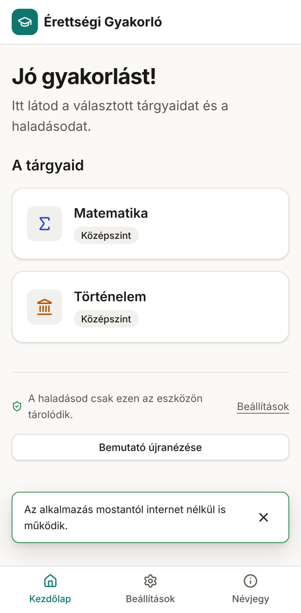
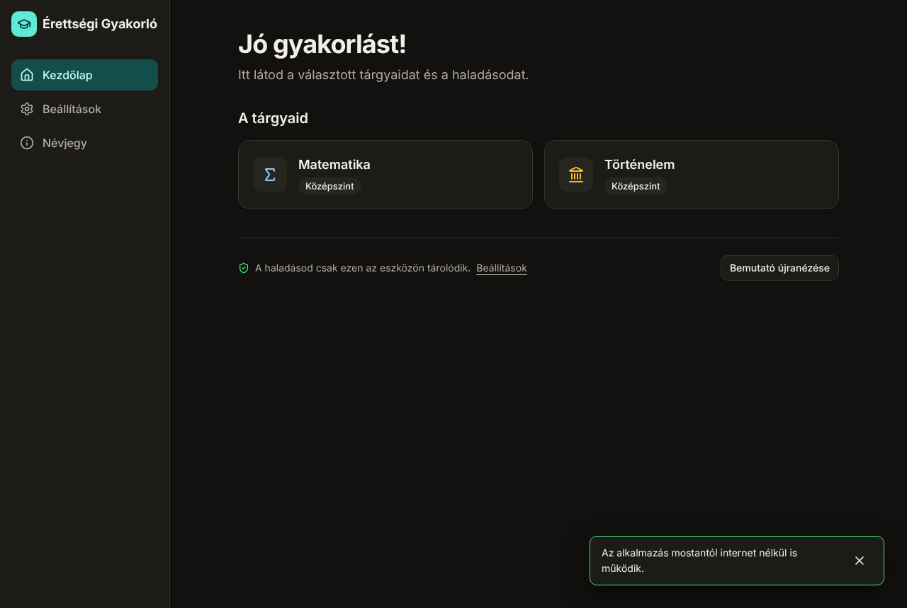

# Érettségi Gyakorló

A free, open-source, ad-free web app for practicing the Hungarian _érettségi_ (school-leaving exam) on real past papers. It runs entirely in the browser: no signup, no backend, no tracking. Works offline once loaded and can be installed as an app (PWA).

**Version 1 scope:** középszint (intermediate level) in Mathematics, History, and Hungarian Language & Literature. Subjects and levels are data, so more can be added without code changes.

Made by **Králik Aladár**. Mistakes, questions and suggestions: [kralik.aladar.gergely@gmail.com](mailto:kralik.aladar.gergely@gmail.com).

> Status: phase 6 of 7 (statistics, home dashboard, result sharing). See [docs/roadmap.md](docs/roadmap.md).

| Mobile (light)                                                   | Desktop (dark)                                                    |
| ---------------------------------------------------------------- | ----------------------------------------------------------------- |
|  |  |

## Diákoknak (for students, in Hungarian)

Nyisd meg az oldalt: **https://kaladarg.github.io/Aladar-Erettsegi-Tanulo-Rendszer/**

- Nem kell regisztrálni, és teljesen ingyenes. Nincs reklám, nincs követés.
- Telefonon a böngésző menüjében a „Hozzáadás a kezdőképernyőhöz” paranccsal alkalmazásként is telepítheted.
- Első betöltés után internet nélkül is működik.
- A haladásod csak a te eszközödön tárolódik. A Beállításokban fájlba mentheted, és másik eszközön visszatöltheted.
- Gyakorolhatsz a saját tempódban, vagy vizsgaszimulációban, a hivatalos időkerettel. Beadás után azonnal megkapod az eredményt; az esszét a javítási útmutató szempontjai szerint te pontozod.
- Gyakorláskor a „Segítség” gombbal megnézheted, mit kér a feladat, tippet kaphatsz, szavakat kereshetsz a Wikiszótárban és a Wikipédiában, és ingyenes, reklámmentes magyar tanulóoldalakat találsz tárgyanként. Kérdezhetsz ingyenes MI-csevegőkben is: az alkalmazás összeállítja és kimásolja a kérdést, te beilleszted. 18 év felett saját Anthropic API-kulccsal az alkalmazáson belül is kérdezhetsz (nem kötelező).
- A Gyakorlás menüben témakörönként gyakorolhatsz az összes feladatsorból; a hibás feladatok a Hibáim közé kerülnek, és 1, 3, majd 7 nap múlva visszatérnek. Megadhatod a vizsgáid dátumát: a Tervem oldal visszaszámol, és heti teendőket ad. A szóbelire tételvázlattal, időmérővel és hangfelvétellel készülhetsz.
- A feladatlapra tollal, kiemelővel rajzolhatsz, az űrlapnézetben pedig minden feladat alatt van rajzlap.
- Vegyes körben több témakör feladatai jönnek összekeverve. Történelemből évszám-, fogalom-, személy- és térképes helyszínkártyákkal, irodalomból szerző-, mű-, korszak- és fogalomkártyákkal gyakorolhatsz. Egy oldalon megnézheted, milyen segédeszközt használhatsz az írásbelin. Az alkalmazás emlékeztet, hogy mentsd el a haladásodat. A tervedet naptárfájlként a telefonod naptárába teheted. Esszéknél mintamegoldásokon gyakorolhatod a pontozást.
- Tanároknak: feladatsor-link és QR-kód a diákoknak, eredménykódok összesítése táblázatba, regisztráció és szerver nélkül.
- A kezdőlapon folytathatod a félbehagyott feladatsort, ajánlást kapsz a következő lépésre, és látod a gyakorlási sorozatodat. A Statisztika oldal megmutatja a fejlődésedet, az erős és gyenge témaköreidet és a hibatípusokat. Az eredményedet képként megoszthatod (név nélkül).

## Quick start (developers)

Requirements: Node.js 20.19+ (22 recommended, see `.nvmrc`). Works on Windows, macOS and Linux.

```bash
git clone https://github.com/kaladarg/Aladar-Erettsegi-Tanulo-Rendszer.git
cd Aladar-Erettsegi-Tanulo-Rendszer
npm install
npm run dev
```

| Command             | What it does                                                                 |
| ------------------- | ---------------------------------------------------------------------------- |
| `npm run dev`       | Dev server with hot reload at http://localhost:5173                          |
| `npm run build`     | Type-checks and builds the static site into `dist/`                          |
| `npm run preview`   | Serves the production build locally                                          |
| `npm test`          | Unit tests (Vitest)                                                          |
| `npm run test:e2e`  | Browser tests (Playwright); run `npx playwright install chromium` once first |
| `npm run lint`      | ESLint and Prettier check                                                    |
| `npm run typecheck` | TypeScript only                                                              |
| `npm run format`    | Formats all files with Prettier                                              |

Serve the built app with Docker (optional):

```bash
docker build -t erettsegi-gyakorlo . && docker run --rm -p 8080:80 erettsegi-gyakorlo
```

## Exam content

Code and content are separate. The app loads exams from a _content pack_: a manifest plus one `exam.json` per paper and optional PDFs. See [docs/content-packs.md](docs/content-packs.md).

- The public site ships a **demo pack** of self-written sample papers (`public/demo-pack`, built with `npm run demo:build`).
- Official papers and marking schemes from the Oktatási Hivatal live in a separate, **private** content repository until their reuse is cleared. They are never committed here; see [CONTENT_LICENSE.md](CONTENT_LICENSE.md).
- Students can open a paper they downloaded from oktatas.hu themselves ("Saját PDF megnyitása"); the app recognises it by its hash and keeps it only on the device.

| Command                                                                         | What it does                                                                     |
| ------------------------------------------------------------------------------- | -------------------------------------------------------------------------------- |
| `npm run demo:build`                                                            | Regenerates the demo pack (PDFs and `exam.json`)                                 |
| `npm run schemas`                                                               | Regenerates types and validators from `schemas/`                                 |
| `npm run content:crawl` / `content:extract` / `content:review` / `content:pack` | Official content pipeline (maintainers)                                          |
| `npm run dev:content`                                                           | Dev server using the private pack checked out at `../erettsegi-gyakorlo-content` |

## Privacy

No ads, no analytics, no third-party trackers, no cookies. All data stays in the browser (IndexedDB). Voice recordings for the oral exam stay on the device; the microphone is used only while recording. Optional AI features use the student's own API key, stored only on their device and never included in exports. Links to free AI chats and learning sites open in a new tab; the app sends them nothing, the student pastes the prepared text.

## Contributing

Contributions from students, teachers and developers are welcome. Start with [CONTRIBUTING.md](CONTRIBUTING.md) and the architecture notes in [docs/](docs/).

## License

Code: [MIT](LICENSE). Exam materials belong to the Oktatási Hivatal and are not covered by the MIT license; see [CONTENT_LICENSE.md](CONTENT_LICENSE.md).
